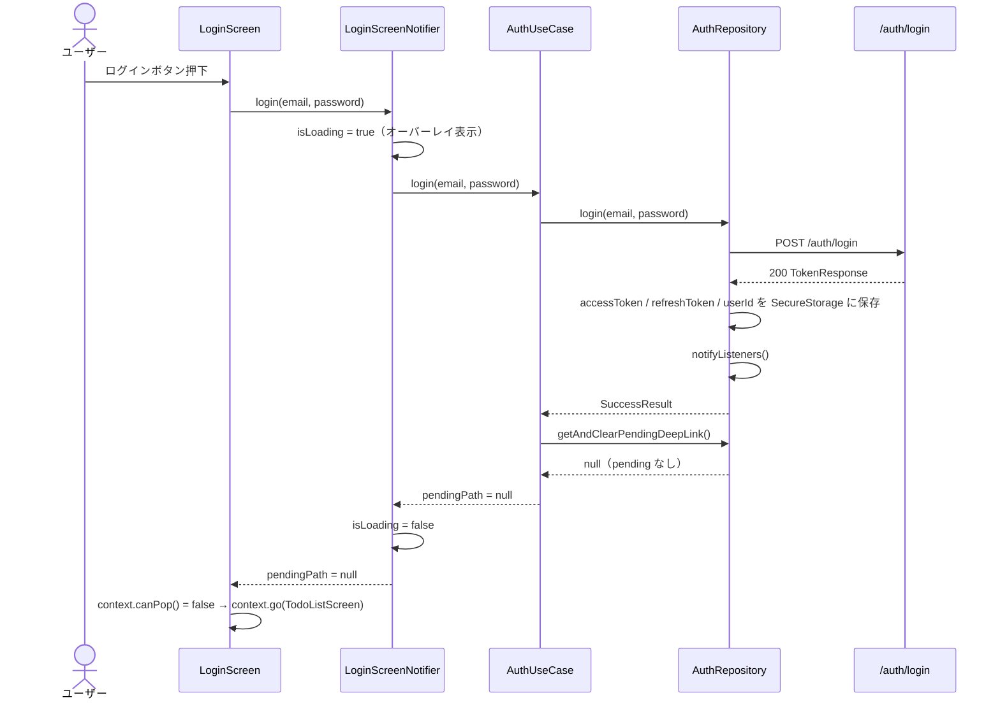
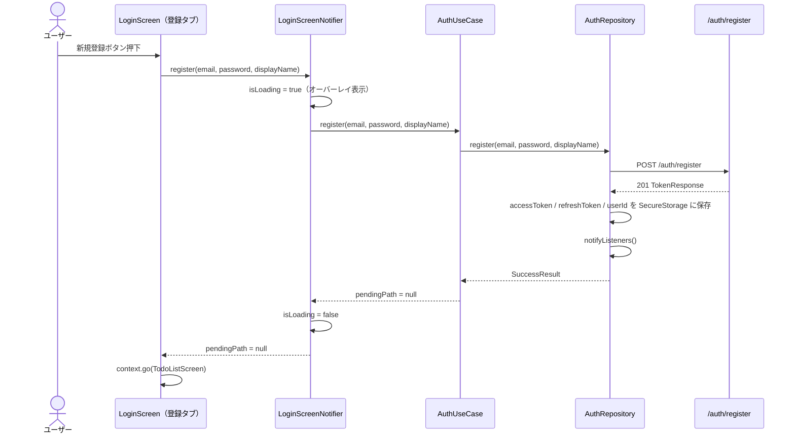
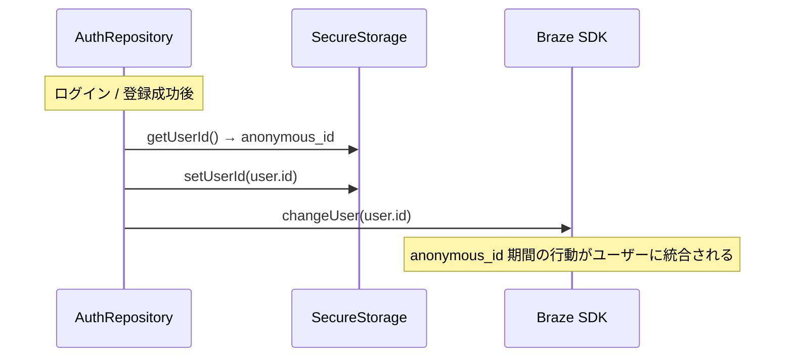
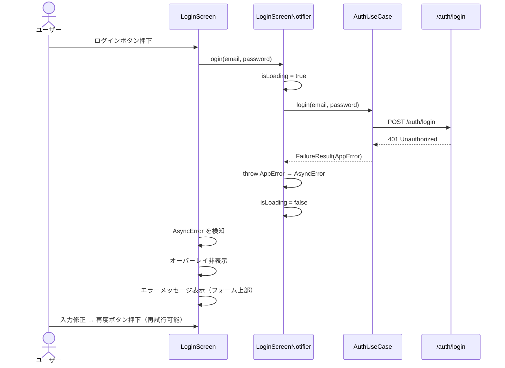

# ログイン機能 デザインドック

## 1. 背景・目的

現状の `router.dart` は未ログインユーザーを全画面でブロックし、LoginScreen へ強制遷移させている。この制約を撤廃し、**未ログインでもアプリを利用できる**設計に変更する。

**解決する課題:**
- 強制ログインがコンバージョン障壁になっている
- 匿名ユーザーを anonymous_id で識別することで Braze Push 通知のカテゴリ配信対象に含められる
- ログイン画面でログインと新規登録を一体化し、ユーザーの離脱を減らす

**ユースケース提案との対応:** `docs/adr/login/use_case_proposal.md`

---

## 2. ユースケース

| パターン | 誰が | どういう時に | 何をする | 今回対応 |
|---|---|---|---|---|
| A | 未登録ユーザー | 初回起動 | ログイン不要でアプリ利用（anonymous_id 発行） | ✅ |
| B | 未ログインユーザー | ログインボタン押下 | ログイン / 新規登録（タブ切り替え） | ✅ |
| C | 未ログインユーザー | 保護画面へ遷移 | ハードガードで LoginScreen へリダイレクト → ログイン後に元の画面へ | ❌（後回し） |
| D | ログインしたユーザー | ログイン完了直後 | anonymous_id → userId の Braze 紐付け | ✅ |
| E（異常系） | ログイン / 登録試行ユーザー | 処理失敗時 | エラーメッセージ表示・再試行可能な状態に戻す | ✅ |

---

## 3. 技術構成

### APIエンドポイント

| メソッド | パス | 用途 | リクエスト | レスポンス |
|---|---|---|---|---|
| POST | `/auth/login` | ログイン | `email`, `password` | `TokenResponse` |
| POST | `/auth/register` | 新規登録 | `email`, `password`, `displayName?` | `TokenResponse` (201) |
| POST | `/auth/refresh` | トークン再発行 | `refreshToken` | `accessToken`, `refreshToken` |
| POST | `/auth/logout` | ログアウト | `refreshToken` | 204 No Content |
| GET | `/auth/me` | ログインユーザー取得 | — (Bearer Token) | `User` |

**TokenResponse スキーマ（`/auth/login` / `/auth/register` 共通）**

```yaml
TokenResponse:
  accessToken: string
  refreshToken: string
  user:
    id: string (uuid)
    email: string
    displayName: string (nullable)
```

### DTO 再設計

`/auth/login` と `/auth/register` が同じ `TokenResponse` を返すため、既存の `LoginDto` を廃止し `TokenResponseDto` に統一する。

| 変更 | ファイル |
|---|---|
| 新規作成 | `lib/data/services/web_api/auth/dto.dart`（`TokenResponseDto` / `UserDto`） |
| 削除 | `lib/data/services/web_api/auth/login/dto.dart`（`LoginDto`） |
| 修正 | `lib/data/repositories/auth/auth_repository.dart`（参照先変更） |

### コンポーネント別の責務

| コンポーネント | 責務 |
|---|---|
| `router.dart`（redirect） | ハードガード対象パスのみ遮断 + `pending_deep_link` 保存 |
| `AuthUseCase` | ログイン / 登録処理・`pending_deep_link` 取得・削除 |
| `LoginScreenNotifier` | UseCase 呼び出し・`isLoading` 管理・エラー変換（`throw` → `AsyncError`） |
| `LoginScreen` | タブ UI・オーバーレイローディング・エラーメッセージ表示・遷移先決定（`go` / `pop`） |
| `AuthRepository` | DTO → Entity 変換・`ApiClientException` → `AppError` 変換・anonymous_id 管理 |

---

## 4. シーケンス図

### パターンB（正常系）— ログイン



### パターンB（正常系）— 新規登録



### パターンD — anonymous_id → userId 紐付け



### パターンE（異常系）— ログイン失敗



---

## 5. LoginScreen UI 仕様

### タブ構成

```
LoginScreen
├── Tab: ログイン
│   ├── TextField: メールアドレス
│   ├── TextField: パスワード
│   └── Button: ログイン
└── Tab: 新規登録
    ├── TextField: メールアドレス
    ├── TextField: パスワード
    ├── TextField: 表示名（任意）
    └── Button: 登録する
```

### ローディング（オーバーレイ）

```
Stack(
  children: [
    _LoginForm(),                    // フォーム（タップ不可）
    if (isLoading)
      ColoredBox(                    // 背景黒・半透明
        color: Colors.black54,
        child: Center(
          child: CircularProgressIndicator(),
        ),
      ),
  ],
)
```

### エラーメッセージ

| HTTPステータス | 表示メッセージ |
|---|---|
| 401 | 「メールアドレスまたはパスワードが正しくありません」 |
| 409 | 「このメールアドレスはすでに登録されています」 |
| 422 | 「入力内容を確認してください」 |
| ネットワークエラー | 「通信エラーが発生しました。再度お試しください」 |
| その他（5xx等） | 「しばらく時間をおいてから再度お試しください」 |

---

## 6. 影響範囲

### 修正が必要な既存ファイル

| ファイル | 変更内容 |
|---|---|
| `lib/router/router.dart` | redirect を「全画面ブロック」→「ハードガード対象のみ」に変更 |
| `lib/domain/use_cases/auth/auth_use_case.dart` | `username` → `email`、`register()` 追加、`savePendingDeepLink()` / `getAndClearPendingDeepLink()` 追加 |
| `lib/data/repositories/auth/auth_repository.dart` | `username` → `email`、`register()` 追加、`LoginDto` → `TokenResponseDto`、anonymous_id 管理追加 |
| `lib/data/services/web_api/auth/login/service.dart` | `username` → `email` |
| `lib/data/services/web_api/auth/login/service_impl.dart` | `username` → `email` |
| `lib/presentation/login/notifier.dart` | `register()` 追加、`isLoading` state 管理、エラー変換 |
| `lib/presentation/login/screen.dart` | タブ UI 追加、オーバーレイローディング、エラーメッセージ、TextField ラベル修正 |

### 新規作成ファイル

| ファイル | 内容 |
|---|---|
| `lib/data/services/web_api/auth/dto.dart` | `TokenResponseDto` / `UserDto`（login・register 共用） |
| `lib/data/services/web_api/auth/register/service.dart` | `AuthRegisterApiService` インターフェース |
| `lib/data/services/web_api/auth/register/service_impl.dart` | `AuthRegisterApiServiceImpl` |
| `lib/data/services/web_api/auth/register/stub_service_impl.dart` | スタブ実装（テスト用） |

### 削除ファイル

| ファイル | 理由 |
|---|---|
| `lib/data/services/web_api/auth/login/dto.dart` | `TokenResponseDto` に統合 |

### 他機能への影響

- **Push 通知（Braze）**: `AuthRepository.login()` 後の `changeUser()` 呼び出しは BRAZE-013 の既存フローに乗る。anonymous_id 管理が追加されるため `AuthSecureStorageService` にキー追加が必要
- **GoRouter**: `refreshListenable` は `authRepositoryProvider` を参照しており、`notifyListeners()` のタイミングは変わらない。redirect ロジックのみ変更

---

## 7. スコープ外（issue 起票）

| 内容 | 理由 |
|---|---|
| パターンC: ログイン必須画面への自動リダイレクト | 対象画面（予約詳細等）が未実装 |
| ログイン後に遷移元画面へ戻る（`extra` で source 明示渡し） | パターンB 完成後に対応。詳細は `braze_004.md` セクション6「未決定事項3」参照 |
| `pending_deep_link` の有効期限管理 | BRAZE-017 で対応。詳細は `braze_004.md` セクション6「未決定事項4」参照 |
| パスワードリセット | 別タスク |
| ソーシャルログイン（Google / Apple） | 別タスク |

---

## 8. スケジュール感

| Day | 作業内容 |
|---|---|
| 1 | デザインドック共有・レビュー |
| 2 | `TokenResponseDto` 新規作成・`LoginDto` 削除・`username` → `email` 修正 |
| 3 | `router.dart` redirect 変更・`AuthUseCase` / `AuthRepository` 修正 |
| 4 | `LoginScreen` タブ UI・ローディング・エラーメッセージ実装 |
| 5 | `LoginScreenNotifier` 修正・register 実装・結合確認・PR |
