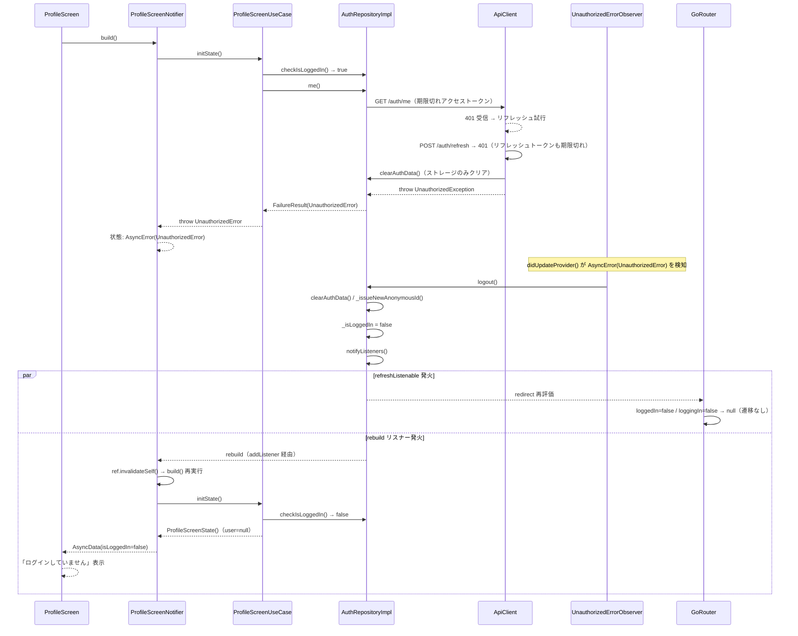

# UnauthorizedErrorObserver と認証フロー整理

## 結論

`lib/utils/unauthorized_error_observer.dart` の`UnauthorizedErrorObserver` は残す。ただし役割を正しく理解する。

---

## ループの本当の原因

Observer でも router でもなく、`ProfileScreenUseCase.initState()` が `isLoggedIn` を確認せずに
`fetchMe()` を呼んでいたことが原因。 対象パス: `lib/presentation/profile/use_case.dart`

```
fetchMe() → 401 → UnauthorizedError → AsyncError
    ↓
Observer 検知 → logout() → _isLoggedIn=false → notifyListeners()
    ↓
ProfileScreenNotifier の rebuild リスナー → invalidateSelf()
    ↓
build() 再実行 → initState() → fetchMe() (isLoggedIn確認なし) → 401 → ...
```

修正（`isLoggedIn = false` なら early return）でループは断ち切られた。

---

## Observer が本当に必要な場面

**セッション切れ（ログイン済み中のトークン期限）**

```
ログイン済みで使用中
    ↓
アクセストークン期限切れ → ApiClient がリフレッシュ試行 → 失敗
    ↓
clearAuthData() はストレージをクリアするが…
AuthRepositoryImpl._isLoggedIn のキャッシュは true のまま
    ↓
Observer なし: isLoggedIn が true を返し続ける → refresh しても API 失敗が続く
Observer あり: logout() → _isLoggedIn=false → rebuild → isLoggedIn=false → early return → "未ログイン" 表示 ✓
```

Observer を削除すると `_isLoggedIn` キャッシュが stale のまま残り、ユーザーはエラー画面でスタックする。

---

## 各コンポーネントの役割

| コンポーネント                              | 実際の役割                                                            | 現状                                                                       |
|---------------------------------------------|-----------------------------------------------------------------------|----------------------------------------------------------------------------|
| `UnauthorizedErrorObserver`                 | セッション切れ時に `_isLoggedIn` キャッシュを false に更新            | ループの原因ではなかった                                                   |
| `router.dart` の redirect                   | ログイン済み + LoginScreen → TaskScreen へ遷移（Pattern C は future） | Pattern C 未実装のため、Observer が logout しても LoginScreen へは飛ばない |
| `ProfileScreenNotifier` の rebuild リスナー | auth 状態変化で画面を再構築                                           | `initState()` に `isLoggedIn` チェックがなかったのが問題（修正済み）       |

---

## TaskScreen は安全

`TaskScreenUseCase.initState()` は `isLoggedIn` を取得するだけで認証付き API
を呼ばないため、Observer → rebuild が発火しても無限ループにはならない。

---

## Pattern C 実装時の完成形

```
セッション切れ → UnauthorizedError
    ↓
Observer → logout() → notifyListeners()
    ↓
router.redirect: isLoggedIn=false かつ protected path → LoginScreen へリダイレクト ← ここを追加
    ↓
ログイン後 pendingDeepLink で元の画面へ復帰
```

Observer はその時点で初めて「自動 LoginScreen 遷移」という本来の役割を果たす。

---

## 今後の画面実装時のパターン

認証が必要な画面を追加するたびに、`initState()` で以下を守る。

```dart
Future<ScreenState> initState() async {
  final isLoggedIn = await ref.read(authUseCaseProvider).checkIsLoggedIn();
  if (!isLoggedIn) {
    return ScreenState(); // API を呼ばずに early return
  }
  // 認証が必要な API 呼び出し
}
```

これにより Observer がある限りループは発生しない。

---

## ProfileScreen 実動作解説（リフレッシュトークン切れ）

`fetchMe()` と同様の「認証付き API 呼び出し → UseCase が throw → Notifier が AsyncError」パターンを
今後の画面実装でも使う。その際の参考として、ProfileScreen でのセッション切れ挙動を完全なフローで記録する。

### 動作条件

- アクセストークン: 期限切れ
- リフレッシュトークン: 期限切れ（両方切れ）

### シーケンス図



### ログと対応箇所

| ログ | 対応箇所 |
|---|---|
| `APIリクエスト: GET /auth/me` | `ApiClient._safeApiCall()` |
| `401 Unauthorizedを検知。トークンの更新を試みます。` | `ApiClient._safeApiCall()` |
| `トークンの更新に失敗しました。ステータスコード: 401` | `ApiClient._handleTokenRefresh()` |
| `予期せぬエラー: ApiClientException: Unauthorized: Session expired` | `ApiClient._safeApiCall()` catch ブロック |
| `[AuthApiServiceImpl] ApiClientException: ...` | `AuthApiServiceImpl.me()` |
| `[AuthRepositoryImpl] ApiClientException: ...` | `AuthRepositoryImpl.me()` |
| `[ProfileScreenUseCase] fetchMe error: Instance of 'UnauthorizedError'` | `ProfileScreenUseCase.fetchMe()` |

エラーログが並ぶが、これは **セッション切れを各レイヤーが正しく伝播・記録した証拠**であり、バグではない。

### 現時点での動作まとめ

| 観点 | 内容 |
|---|---|
| Observer の動作 | 正常（UnauthorizedError を検知 → logout() 実行）|
| `_isLoggedIn` の更新 | 正常（true → false）|
| LoginScreen への自動遷移 | **発生しない**（Pattern C 未実装のため redirect が null を返す）|
| 最終的な UI | ProfileScreen が「ログインしていません + ログインボタン」を表示 |

この挙動は現時点での**設計通りの暫定動作**。Pattern C 実装後は redirect が LoginScreen へ遷移する。
参照: `use_case_proposal.md` の「パターンC: ログイン必須画面への遷移（予約詳細など）」

### 参考：ProfileScreen の実装コード

```dart
// ProfileScreenUseCase
Future<ProfileScreenState> initState() async {
  final isLoggedIn = await ref.read(authUseCaseProvider).checkIsLoggedIn();
  if (!isLoggedIn) {
    return const ProfileScreenState(); // early return（API を呼ばない）
  }
  final user = await fetchMe();
  return ProfileScreenState(user: user, isLoggedIn: isLoggedIn);
}

Future<User> fetchMe() async {
  final result = await ref.read(authRepositoryProvider).me();
  return switch (result) {
    SuccessResult(:final value) => value,
    FailureResult(:final error) => () {
      logger.e(message: '[ProfileScreenUseCase] fetchMe error: $error');
      throw error; // Notifier を AsyncError に遷移させ Observer に検知させる
    }(),
  };
}
```

```dart
// ProfileScreenNotifier
@override
Future<ProfileScreenState> build() async {
  final repo = ref.read(authRepositoryProvider);
  void rebuild() => ref.invalidateSelf();
  repo.addListener(rebuild);
  ref.onDispose(() => repo.removeListener(rebuild));
  // logout() → notifyListeners() → rebuild が発火し、認証状態変化に追従する
  return await ref.read(profileScreenUseCaseProvider).initState();
}
```

**ポイント**:
- `initState()` は `isLoggedIn=false` で early return → API を呼ばない → ループ回避
- `fetchMe()` は `throw error` → Notifier が `AsyncError` に遷移 → Observer が検知
- Notifier は `addListener(rebuild)` → `logout()` 後の `notifyListeners()` で自動 rebuild
