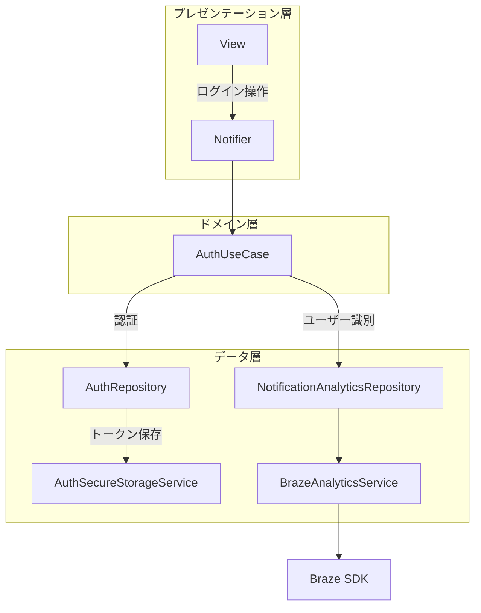
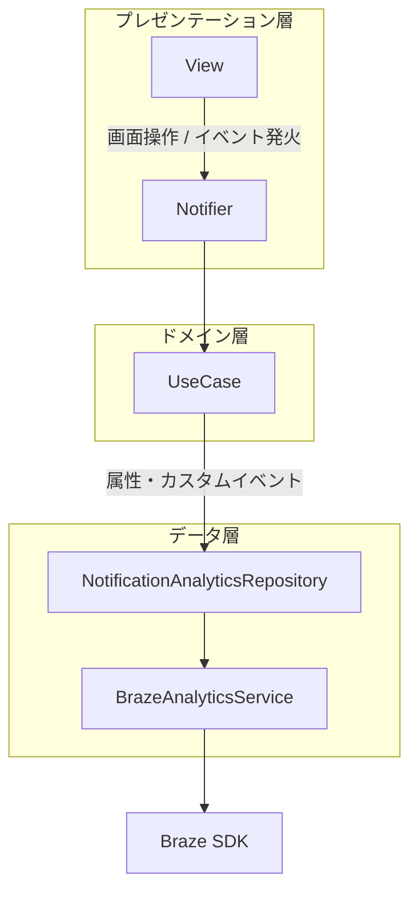

# BRAZE-001 Braze連携の現状調査

## 内容

既存のBraze SDK有無、Firebase Messaging設定、通知権限実装、Deep Link実装、認証基盤を調査する

## 完了条件

影響ファイル一覧と現状メモを作成する

---

## 調査結果

### 現状サマリ

| 調査項目 | 状態 | 備考 |
|---|---|---|
| Braze SDK | **未導入** | `pubspec.yaml` に `braze_plugin` なし |
| Firebase Messaging | **未導入** | `pubspec.yaml` に `firebase_messaging` / `firebase_core` なし |
| 通知権限実装 | **未実装** | `permission_handler` なし。iOS `Info.plist`・Android `AndroidManifest.xml` に通知関連の設定なし |
| Deep Link実装 | **未実装** | URLスキーム・Universal Links・App Links の設定なし |
| 認証基盤 | **実装済み** | アクセストークン管理・ログイン/ログアウト処理あり。詳細は下記 |

---

### 認証基盤の現状

#### ログイン状態管理

- `AuthRepository` (`lib/data/repositories/auth/auth_repository.dart`)
  - `ChangeNotifier` を継承
  - `login()` / `logout()` 後に `notifyListeners()` → GoRouterの `refreshListenable` に接続済み
  - アクセストークン・リフレッシュトークンを `flutter_secure_storage` で保持
  - **user_id は現状保存していない**（`accessToken` の有無でログイン判定）

- `AuthUseCase` (`lib/domain/use_cases/auth/auth_use_case.dart`)
  - `checkIsLoggedIn()` / `login()` / `logout()` を公開
  - Braze `changeUser` の呼び出し起点として適切

- `LoginDto` (`lib/data/services/web_api/auth/login/dto.dart`)
  - `accessToken` / `refreshToken` を保持
  - **Brazeへ渡す `user_id` がレスポンスに含まれるか要確認**（サーバー側仕様次第）

#### GoRouterの構成

`lib/router/router.dart`

- `refreshListenable: ref.read(authRepositoryProvider)` — 認証状態変化でリダイレクト再評価
- `redirect` で `checkIsLoggedIn()` を呼び未ログイン時は `/login` へ
- 現在定義済みのルートパス:

| パス | 画面 |
|---|---|
| `/login` | LoginScreen |
| `/todo_list` | TodoListScreen |
| `/todo_list/:todoId` | TodoDetailScreen |
| `/task` | TaskScreen |
| `/profile` | ProfileScreen |
| `/debug` | DebugMenuScreen（kDebugMode限定） |

- 通知タップ後の Deep Link 受信処理は**未実装**
- GoRouter の `initialLocation` は `/todo_list` 固定（冷起動時の Deep Link 対応は別途設計が必要）

#### アプリ初期化

`lib/main.dart`

- `WidgetsFlutterBinding.ensureInitialized()` 呼び済み
- `SharedPreferencesWithCache` を `runApp()` 前に初期化し、`ProviderScope.overrides` で注入
- Riverpod `ProviderScope` → Braze SDK 初期化もここへ追加できる構造

---

### 影響ファイル一覧

#### 処理フロー概要

**ログイン時（changeUser）**

**画面操作時（属性・カスタムイベント送信）**

#### 既存ファイル（変更が必要）

| ファイル | 変更内容 |
|---|---|
| `pubspec.yaml` | `braze_plugin: ^23.0.0` 追加 |
| `lib/main.dart` | Braze SDK 初期化（`WidgetsFlutterBinding.ensureInitialized()` 後） |
| `lib/data/repositories/auth/auth_repository.dart` | `login()` 後に `changeUser(userId)`、`logout()` 後に Braze ログアウト処理を追加 |
| `lib/domain/use_cases/auth/auth_use_case.dart` | `login()` / `logout()` で `NotificationAnalyticsRepository` 経由の Braze 操作を追加 |
| `lib/router/router.dart` | 通知タップ時の Deep Link 受信 → GoRouter 遷移処理を追加 |
| `ios/Runner/Info.plist` | Push通知権限説明文、URLスキーム、APN 設定 |
| `ios/Runner.xcodeproj/project.pbxproj` | Push Notifications・Background Modes ケイパビリティ追加 |
| `android/app/src/main/AndroidManifest.xml` | `POST_NOTIFICATIONS` 権限、Deep Link intent-filter 追加 |

#### 新規作成が必要なファイル

| ファイル | 役割 |
|---|---|
| `lib/data/services/braze/braze_analytics_service.dart` | Braze SDK 呼び出しの抽象インターフェース |
| `lib/data/services/braze/braze_analytics_service_impl.dart` | `braze_plugin` を使った実装 |
| `lib/data/services/braze/stub_braze_analytics_service_impl.dart` | テスト用スタブ |
| `../../../../lib/data/repositories/permission/notification/notification_analytics_repository.dart` | 属性・カスタムイベント送信の集約（UI から直接 SDK を呼ばない） |
| `../../../../lib/domain/use_cases/permission/notification/notification_permission_use_case.dart` | Push 権限取得・状態管理 |
| `lib/presentation/notification_settings/screen.dart` 等 | 通知設定UI（カテゴリ別 ON/OFF・マーケ同意）（Phase 3） |

---

## 未決定事項

| # | 未決定事項 | 内容 | 対応案 | 決定チケット |
|---|---|---|---|---|
| 1 | `user_id` の取得方法 | Braze `changeUser` に渡す `user_id` が現状未保存（`accessToken` 有無のみで判定） | A: `LoginDto` にサーバーが `user_id` を含めるよう API 変更 → `AuthSecureStorage` へ保存 B: ログイン後に `UserRepository.fetchMe()` で取得 → `AuthRepository` に `userId` フィールド追加 | `BRAZE-003` |
| 2 | `LoginDto` への `user_id` 追加可否 | サーバー側レスポンスに `user_id` が含まれるか未確認 | サーバー仕様を確認し、未対応なら案B（`fetchMe()`）で対処 | `BRAZE-003` |
| 3 | Braze 初期化の環境別 API キー管理 | dev / staging / prod でワークスペースを分離する方式が未設計 | `SharedPreferencesWithCache` と同パターンで `runApp()` 前に初期化 | `BRAZE-011` |
| 4 | 冷起動時 Deep Link の GoRouter 連携 | `initialLocation` 固定のため、通知タップ冷起動で正しい画面へ遷移できない | `BrazePlugin` の通知タップコールバックで `router.go(deepLinkPath)` を呼ぶ。未ログイン時は `redirect` 内で保留遷移先を保持 | `BRAZE-004` |
| 5 | 通知カテゴリの確定（初期4カテゴリの定義承認） | `booking_transaction` / `trip_preparation` / `trip_support` / `marketing_offer` の定義・初期値・抑制条件を関係者承認 | category_design_proposal.md の推奨最小構成を採用 | `BRAZE-002` |
| 6 | Brazeへ送るデータスキーマの確定 | 属性名・型・送信タイミング・送信責務を文書化（`user_id` 取得方法と連動） | design_doc.md の「画面・タイミング別データ送信設計」を基に確定 | `BRAZE-003` |
| 7 | Deep Link スキーマの確定 | 通知タップ後の遷移先パス・パラメータ・未ログイン時挙動が未設計 | `booking/:id` / `plan/:id` / `settings/notifications` 等のスキーマを承認 | `BRAZE-004` |
| 8 | 権限・同意フロー設計 | OS Push 権限・マーケ同意・カテゴリ別設定の関係と画面フローが未設計 | 画面フローと状態遷移図を作成・承認 | `BRAZE-005` |
