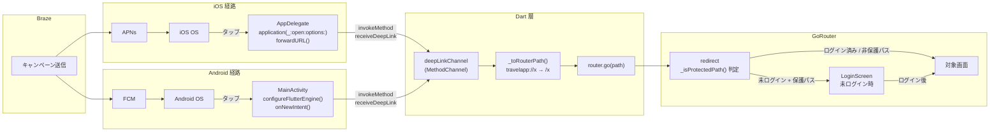
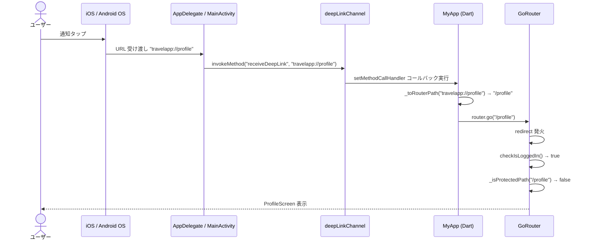
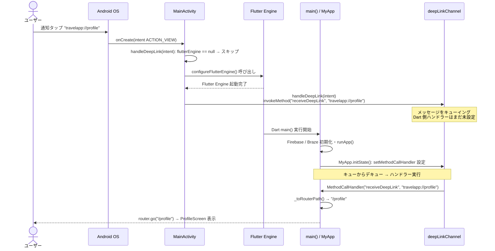
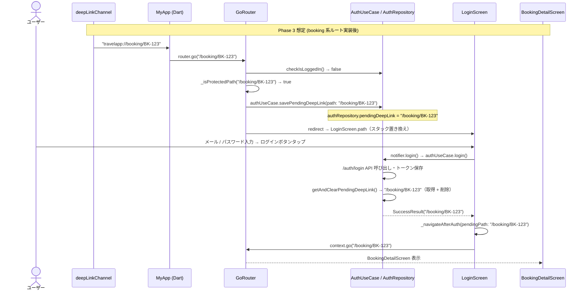

# BRAZE-017 通知タップ遷移（縮小版）

## 概要

Brazeの Push通知タップ時に、通知に紐付いた `travelapp://` Deep Link を受け取り、
アプリ内の対応画面へ遷移するインフラを構築する。

Phase 2縮小版のため、遷移先は既存ルート（`/task`, `/profile`）のみに限定。
ハードガード対象のルート定義（`/booking`, `/my-trips/:id`）は骨格のみ実装し、
Phase 3で保護画面が追加された時点で機能する状態にしておく。

---

## 完了条件

- `travelapp://` スキームのURLをiOS/Androidのネイティブ層で受け取り、Dartレイヤーに転送できる
- DartレイヤーでURLをgo_routerパスに変換し `router.go()` で遷移できる
- router.dart の redirect がハードガード対象パスのみ保護する（現在の既存ルートは保護対象なし）
- 未ログイン時にハードガード対象パスへアクセスした場合、`pending_deep_link` を保存してLoginScreenへリダイレクトする
- ログイン後に `pending_deep_link` が存在する場合、LoginScreenが `context.go(pendingPath)` で遷移する
- ログイン後に `pending_deep_link` がない場合、LoginScreenが `context.pop()` またはTaskScreen.pathへ遷移する

---

## フロー図

### 全体アーキテクチャ

Braze SDKから対象画面までの経路概要。iOSとAndroidで通知配信経路が異なる。



---

### シナリオ A: 起動中・ログイン済み（iOS / Android 共通）

フォアグラウンド / バックグラウンドで起動中のアプリへ通知が届きタップした場合。
iOS / Android ともに同じ Dart 層フローを経由する。



---

### シナリオ B: 冷起動・ログイン済み（Android）

アプリ未起動状態で通知をタップし冷起動が発生した場合の Android 固有フロー。
iOS は Braze SDK が `application(_:open:options:)` を起動完了後に呼ぶため本シナリオは Android のみ。

ポイント: `onCreate` では `flutterEngine` が null のため MethodChannel 送信が行えない。
`configureFlutterEngine` でエンジンが起動してから送信し、Flutter Engine のメッセージキューに
キューイングさせることで、Dart 側の `setMethodCallHandler` 設定後に確実に処理される。



---

### シナリオ C: 未ログイン・ハードガード対象パス（Phase 3 想定）

Phase 3 で booking 系ルートが追加された後、未ログイン状態で保護画面への通知をタップした場合。
`pending_deep_link` 保留遷移の仕組みを示す。
Phase 2 縮小版では既存ルートに保護対象がないため実際には発動しないが、
骨格実装は本チケットで完了させる。



---

## 設計決定

### 1. deepLinkChannel のDartセットアップ場所

**決定**: `MyApp` を `ConsumerStatefulWidget` に変更し、`initState` 内で設定する。

理由:
- `router.go()` 呼び出しに `ref.read(routerProvider)` が必要 → Widget内が自然
- `main.dart` の `ProviderContainer` から直接 `router.go()` を呼ぶと GoRouter の Navigator が Widget Tree 構築前で使えない

```dart
class _MyAppState extends ConsumerState<MyApp> {
  @override
  void initState() {
    super.initState();
    MethodChannel('deepLinkChannel').setMethodCallHandler((call) async {
      final url = call.arguments as String?;
      if (url == null) return;
      final path = _toRouterPath(url);
      if (path != null) ref.read(routerProvider).go(path);
    });
  }
}
```

### 2. 冷起動時のAndroid対応

**決定**: `MainActivity.configureFlutterEngine` 内で `handleDeepLink(intent)` を呼ぶ。

理由:
- `configureFlutterEngine` 時点で `flutterEngine.dartExecutor.binaryMessenger != null` が保証される
- `onCreate` では `flutterEngine` が null の場合があり、MethodChannel 送信が失われる
- Flutter Engine のメッセージキューの性質上、Dart側の `setMethodCallHandler` 設定前に送っても、設定後に処理される

### 3. pending_deep_link の保存方式

**決定**: インメモリのみ（SharedPreferencesへの永続化なし）。

理由:
- Phase 2縮小版ではハードガード対象画面が存在しないため、冷起動時に保護画面へのDeep Linkが発生しない
- Phase 3でハードガード対象画面が実装された時点で SharedPreferences 永続化を追加する

### 4. LoginScreen の source 明示渡し採用可否

**決定**: 採用しない（Phase 3で再検討）。

理由:
- Phase 2縮小版ではハードガード対象画面がなく、stale pendingPath 問題が発生しない
- `canPop()` + `pendingPath` の組み合わせで判断する BRAZE-004 の基本設計を採用

### 5. URL → go_router パス変換規則

`travelapp://{host}/{path...}` → `/{host}/{path...}`

| Deep Link URL | go_router パス |
|---|---|
| `travelapp://task` | `/task` |
| `travelapp://profile` | `/profile` |
| `travelapp://booking/BK-123` | `/booking/BK-123`（Phase 3） |

`Uri.tryParse(url)` で `scheme == 'travelapp'` を確認し、`host` + `path` を結合。

### 6. deepLinkChannel の method 名

iOS/Android 間で `"receiveDeepLink"` に統一する。
（Brazeサンプルはレイヤー間で名前が異なるが、一貫性のために統一）

---

## 変更ファイル一覧

| 操作 | ファイル |
|---|---|
| **修正** | `lib/main.dart` |
| **修正** | `lib/router/router.dart` |
| **修正** | `lib/domain/use_cases/auth/auth_use_case.dart` |
| **修正** | `lib/presentation/login/notifier.dart` |
| **修正** | `lib/presentation/login/screen.dart` |
| **修正** | `ios/Runner/AppDelegate.swift` |
| **修正** | `ios/Runner/Info.plist` |
| **修正** | `android/app/src/main/kotlin/com/example/travel_app/MainActivity.kt` |
| **修正** | `android/app/src/main/AndroidManifest.xml` |

テストファイルへの変更は不要。
`notifier.login()` / `notifier.register()` の戻り値が `Future<void>` → `Future<String?>` に変わるが、
既存テストは戻り値を使っていないため影響なし。

---

## 実装詳細

### `lib/main.dart`（修正）

`MyApp` を `ConsumerStatefulWidget` に変更し、`initState` で `deepLinkChannel` を設定する。

追加 import:
```dart
import 'package:flutter/services.dart';
```

変更後のクラス定義:
```dart
class MyApp extends ConsumerStatefulWidget {
  const MyApp({super.key});

  @override
  ConsumerState<MyApp> createState() => _MyAppState();
}

class _MyAppState extends ConsumerState<MyApp> {
  @override
  void initState() {
    super.initState();
    MethodChannel('deepLinkChannel').setMethodCallHandler((call) async {
      final url = call.arguments as String?;
      if (url == null) return;
      final path = _toRouterPath(url);
      if (path != null) ref.read(routerProvider).go(path);
    });
  }

  @override
  Widget build(BuildContext context) {
    final router = ref.watch(routerProvider);
    return MaterialApp.router(
      title: 'Flutter Demo',
      theme: ThemeData(
        colorScheme: ColorScheme.fromSeed(seedColor: Colors.blue),
        useMaterial3: true,
      ),
      routerConfig: router,
    );
  }
}

// travelapp://task → /task, travelapp://booking/BK-123 → /booking/BK-123
String? _toRouterPath(String url) {
  final uri = Uri.tryParse(url);
  if (uri == null || uri.scheme != 'travelapp') return null;
  final path = '/${uri.host}${uri.path}';
  return path == '/' ? null : path;
}
```

---

### `lib/router/router.dart`（修正）

`_isProtectedPath()` をトップレベル関数として `routerProvider` の外に追加。

```dart
bool _isProtectedPath(String path) {
  const protectedPrefixes = [
    '/booking',   // ハードガード: booking系（Phase 3で使用）
    '/my-trips/', // ハードガード: 旅程詳細のみ（末尾スラッシュで一覧を除外）
  ];
  return protectedPrefixes.any((prefix) => path.startsWith(prefix));
}
```

redirect の変更（`loggingIn` 変数を削除し BRAZE-004 の設計に置き換え）:

```dart
redirect: (context, state) async {
  final loggedIn = await ref.read(authUseCaseProvider).checkIsLoggedIn();
  logger.d(message: 'state.matchedLocation: ${state.matchedLocation}');
  final path = state.matchedLocation;

  if (!loggedIn && _isProtectedPath(path)) {
    ref.read(authUseCaseProvider).savePendingDeepLink(path: path);
    return LoginScreen.path;
  }

  if (loggedIn && path == LoginScreen.path) {
    return TaskScreen.path;
  }

  return null;
},
```

---

### `lib/domain/use_cases/auth/auth_use_case.dart`（修正）

`savePendingDeepLink()` メソッドを追加（router.dart の redirect から呼ばれる）:

```dart
// ignore: use_setters_to_change_properties
void savePendingDeepLink({required String path}) {
  ref.read(authRepositoryProvider).pendingDeepLink = path;
}
```

`lint: use_setters_to_change_properties` への対応として ignore コメントを付与。
getter は使用箇所がないため YAGNI により定義しない。

---

### `lib/presentation/login/notifier.dart`（修正）

`login()` / `register()` の戻り値を `Future<void>` → `Future<String?>` に変更し、
ログイン後の遷移先パス（`pending_deep_link`）を呼び出し元へ返す。

`login()` の変更:
```dart
Future<String?> login({required String email, required String password}) async {
  final isLoading = switch (state) {
    AsyncData(:final value) => value.isLoading,
    _ => false,
  };
  if (isLoading) return null;
  state = const AsyncData(LoginScreenState(isLoading: true));
  final result = await ref
      .read(authUseCaseProvider)
      .login(email: email, password: password);
  switch (result) {
    case SuccessResult<String?>():
      state = const AsyncData(LoginScreenState());
      return result.value;
    case FailureResult<String?>(:final error):
      logger.e(message: '[LoginScreenNotifier] auth failed: $error');
      state = AsyncError(error, StackTrace.current);
      return null;
  }
}
```

`register()` も同様に `Future<String?>` に変更し、`SuccessResult` 時に `result.value` を返す。

---

### `lib/presentation/login/screen.dart`（修正）

追加 import:
```dart
import 'package:go_router/go_router.dart';
import 'package:travel_app/presentation/task/screen.dart';
```

ファイルスコープのヘルパー関数を追加:
```dart
void _navigateAfterAuth({
  required BuildContext context,
  required String? pendingPath,
}) {
  if (pendingPath != null && pendingPath.isNotEmpty) {
    context.go(pendingPath);
  } else if (context.canPop()) {
    context.pop();
  } else {
    context.go(TaskScreen.path);
  }
}
```

`_LoginForm` の onPressed を変更:
```dart
onPressed: () async {
  final pendingPath = await notifier.login(
    email: emailController.text,
    password: passwordController.text,
  );
  if (!context.mounted) return;
  _navigateAfterAuth(context: context, pendingPath: pendingPath);
},
```

`_RegisterForm` の onPressed を変更:
```dart
onPressed: () async {
  final displayName = displayNameController.text.isEmpty
      ? null
      : displayNameController.text;
  final pendingPath = await notifier.register(
    email: emailController.text,
    password: passwordController.text,
    displayName: displayName,
  );
  if (!context.mounted) return;
  _navigateAfterAuth(context: context, pendingPath: pendingPath);
},
```

---

### `ios/Runner/AppDelegate.swift`（修正）

カスタムスキーム受信のメソッドと `forwardURL()` を追加。
現在の AppDelegate は `FlutterImplicitEngineDelegate` を使っているため、
`UIApplication.shared.connectedScenes` 経由で `FlutterViewController` を取得する。

```swift
// MARK: - Deep Link Forwarding

extension AppDelegate {

  private func forwardURL(_ url: URL) {
    guard
      let scene = UIApplication.shared.connectedScenes.first as? UIWindowScene,
      let controller = scene.windows.first?.rootViewController as? FlutterViewController
    else { return }
    let deepLinkChannel = FlutterMethodChannel(
      name: "deepLinkChannel", binaryMessenger: controller.binaryMessenger)
    DispatchQueue.main.async {
      deepLinkChannel.invokeMethod("receiveDeepLink", arguments: url.absoluteString)
    }
  }

  override func application(
    _ app: UIApplication,
    open url: URL,
    options: [UIApplication.OpenURLOptionsKey: Any] = [:]
  ) -> Bool {
    forwardURL(url)
    return true
  }
}
```

---

### `ios/Runner/Info.plist`（修正）

`CFBundleURLTypes` を追加:
```xml
<key>CFBundleURLTypes</key>
<array>
  <dict>
    <key>CFBundleURLSchemes</key>
    <array>
      <string>travelapp</string>
    </array>
  </dict>
</array>
```

---

### `android/app/src/main/kotlin/com/example/travel_app/MainActivity.kt`（修正）

```kotlin
package com.example.travel_app

import android.content.Intent
import io.flutter.embedding.android.FlutterActivity
import io.flutter.embedding.engine.FlutterEngine
import io.flutter.plugin.common.MethodChannel
import io.flutter.plugins.GeneratedPluginRegistrant

class MainActivity : FlutterActivity() {
  override fun configureFlutterEngine(flutterEngine: FlutterEngine) {
    super.configureFlutterEngine(flutterEngine)
    GeneratedPluginRegistrant.registerWith(flutterEngine)
    // 冷起動時: FlutterEngine 起動後に intent の Deep Link を Dart へ転送
    handleDeepLink(intent)
  }

  override fun onNewIntent(intent: Intent) {
    super.onNewIntent(intent)
    setIntent(intent)
    handleDeepLink(intent)
  }

  private fun handleDeepLink(intent: Intent) {
    val binaryMessenger = flutterEngine?.dartExecutor?.binaryMessenger
    if (intent.action == Intent.ACTION_VIEW && binaryMessenger != null) {
      MethodChannel(binaryMessenger, "deepLinkChannel")
        .invokeMethod("receiveDeepLink", intent.data.toString())
    }
  }
}
```

---

### `android/app/src/main/AndroidManifest.xml`（修正）

`MainActivity` の `<activity>` ブロックに intent-filter を追加:

```xml
<!-- travelapp:// カスタムスキームの受信 -->
<intent-filter>
  <action android:name="android.intent.action.VIEW" />
  <category android:name="android.intent.category.DEFAULT" />
  <category android:name="android.intent.category.BROWSABLE" />
  <data android:scheme="travelapp" />
</intent-filter>
```

---

## テスト方針

既存テスト（`login_screen_notifier_integration_test.dart`）はそのまま通る。
`notifier.login()` の戻り値が `Future<String?>` に変わるが、テスト側で戻り値を使っておらず影響なし。

router の redirect ロジックは現在の既存ルートでは `_isProtectedPath()` がすべて `false` を返すため、
実質的に動作変更なし。Phase 3で保護画面が追加された時点でテストを追加する。

---

## 残課題（Phase 3以降）

| # | 課題 | 内容 |
|---|---|---|
| 1 | pending_deep_link の SharedPreferences 永続化 | ハードガード対象画面（booking系）追加時に対応 |
| 2 | LoginScreen の source 明示渡し | stale pendingPath 問題の根本解決。`context.push('/login', extra: {'source': 'soft_guard'})` パターン採用を検討 |
| 3 | pending_deep_link の有効期限 | 保存後24時間 or セッション中のみに制限するか |

---

## スコープ外

| 内容 | チケット |
|---|---|
| `/booking/:bookingId` への遷移（画面未実装） | Phase 3 |
| `/my-trips/:bookingId` への遷移（画面未実装） | Phase 3 |
| Universal Links / App Links 対応 | 別途ロードマップ |
| 通知設定画面 `/settings/notifications` | Phase 3 |

---

## Q&A

### Q. FCMコンソールから通知を送っても、通知タップ後のDeep Link遷移は動作するか？

**A. 動作しない。**

BRAZE-017 の実装はBraze本番環境向けの設計であり、FCMコンソール単体でのDeep Link遷移テストはできない。以下にその理由と代替テスト手順を記録する。

---

#### なぜ動かないか

`handleDeepLink` の発動条件を見ると:

```kotlin
private fun handleDeepLink(intent: Intent) {
    val binaryMessenger = flutterEngine?.dartExecutor?.binaryMessenger
    if (intent.action == Intent.ACTION_VIEW && binaryMessenger != null) { // ← ここ
        MethodChannel(binaryMessenger, "deepLinkChannel")
            .invokeMethod("receiveDeepLink", intent.data.toString())
    }
}
```

`intent.action == Intent.ACTION_VIEW` が前提。この Intent を発行するのは **Braze SDK のみ**。

| 通知の送信元 | 通知タップ時の intent.action | handleDeepLink 発動 |
|---|---|---|
| **Braze Dashboard** | `ACTION_VIEW`（Braze SDKが発行） | ✅ |
| **FCMコンソール** | `android.intent.action.MAIN`（OS起動） | ❌ |
| **ADB** | `ACTION_VIEW`（手動指定） | ✅ |

Braze SDK は通知タップ時に Deep Link URL を `ACTION_VIEW` の Intent に変換して MainActivity を起動する。これは Braze 固有の動作であり、FCMコンソールから送った通知にはこの変換が行われない。

FCMコンソールからの通知タップは Flutter 側では `FirebaseMessaging.onMessageOpenedApp` / `getInitialMessage()` で受け取るのが正しいアプローチ（FCM公式ドキュメントの方法）だが、BRAZE-017 の実装にはこれが含まれていない。これは意図的な設計で、Braze がその役割を担うため不要。

---

#### 状態別の実際の挙動

**FCMコンソールで通知を送った場合**

| 状態 | 通知の表示 | 通知タップ後の画面遷移 |
|---|---|---|
| **バックグラウンド** | ✅ Android OSが自動表示 | ❌ `handleDeepLink` 非発動（`onMessageOpenedApp` 未実装） |
| **ターミネート** | ✅ Android OSが自動表示 | ❌ `handleDeepLink` 非発動（`getInitialMessage()` 未実装） |
| **フォアグラウンド** | ❌ 自動表示されない（`onMessage` 未実装） | — |

**Braze Dashboardで通知を送った場合（本番）**

| 状態 | 通知の表示 | 通知タップ後の画面遷移 |
|---|---|---|
| **バックグラウンド** | ✅ Braze SDKが自動表示 | ✅ `ACTION_VIEW` → `handleDeepLink` 発動 |
| **ターミネート** | ✅ Braze SDKが自動表示 | ✅ `configureFlutterEngine` → `handleDeepLink` 発動 |
| **フォアグラウンド** | ✅ Braze SDKが自動表示 | ✅ 同上 |

---

#### Pixel実機でのテスト方法

「通知が届くか」と「タップで遷移するか」を分けてテストする。

**Step 1: 通知の受信確認 → FCMコンソールで送る**

FCMコンソールからテスト通知を送ってPixelに届くかを確認する。通知の表示は Braze SDK とは独立しているため、バックグラウンド / ターミネート状態では問題なく届く。

**Step 2: Deep Link遷移の確認 → ADBで直接Intentを送る**

```bash
# バックグラウンドまたはターミネート状態でそれぞれ実行
adb shell am start \
  -a android.intent.action.VIEW \
  -d "travelapp://profile" \
  com.example.travel_app

adb shell am start \
  -a android.intent.action.VIEW \
  -d "travelapp://task" \
  com.example.travel_app
```

ADBでの `ACTION_VIEW` 送信は、Braze SDKが通知タップ時に発行する Intent と全く同じ経路を通る。
`handleDeepLink` → MethodChannel → `_toRouterPath()` → `router.go()` の全コードパスを、Brazeなしで検証できる。

**Step 3: 未ログイン時の保留遷移確認（Phase 3の骨格確認）**

```bash
# ログアウト後に実行
adb shell am start \
  -a android.intent.action.VIEW \
  -d "travelapp://booking/BK-123" \
  com.example.travel_app
# → redirect が発火し、LoginScreen へリダイレクトされる
# → ログイン後に /booking/BK-123 へ遷移することを確認
```

---

#### まとめ

- BRAZE-017 の実装は **Braze本番環境では正しく動作する**。FCM + Braze SDK の組み合わせで `ACTION_VIEW` が発火するため。
- FCMコンソール単体でのend-to-endテスト（通知タップ → Deep Link遷移）はできない。これは設計上の意図的なトレードオフであり、FCM公式ドキュメントで紹介されている `onMessageOpenedApp` / `getInitialMessage()` は Braze がその役割を代替するため実装不要。
- 実機での確認は **ADB** を使うのが最も確実。Brazeなしで本番コードパスを全て検証できる。
